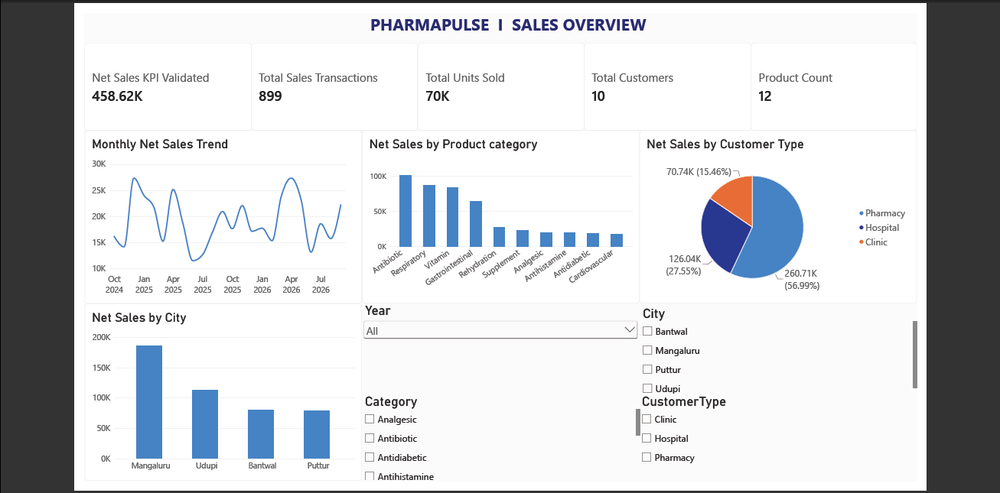
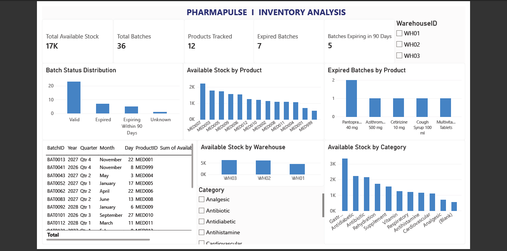
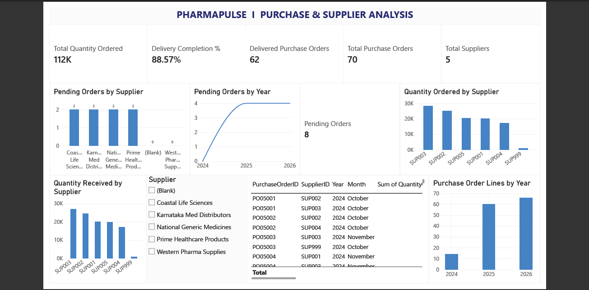

PharmaPulse – Pharmaceutical Wholesale Distribution Analytics

Project Overview

PharmaPulse is a Business Intelligence project focused on analysing pharmaceutical wholesale distribution operations. It uses data analytics and interactive Power BI dashboards to monitor sales performance, inventory levels, product expiry and supplier operations.

Business Objectives

- Analyse sales trends and revenue performance.
- Monitor available inventory and batch expiry.
- Identify expired and soon-to-expire batches.
- Evaluate supplier performance and purchase order delivery.
- Support better inventory and operational decisions.

Tools & Technologies

- Microsoft Power BI
- Power Query – Data cleaning and transformation
- DAX – Measures and calculations
- Microsoft Excel – Data preparation and documentation

Dashboard Pages

1. Sales Overview

- Net sales performance
- Monthly sales trends
- Sales by product category
- Customer type and city analysis

2. Inventory Analysis

- Available stock by product and warehouse
- Batch status distribution
- Expired batches
- Batches expiring within 90 days

3. Purchase & Supplier Analysis

- Total quantity ordered
- Delivery completion rate
- Pending purchase orders
- Supplier-wise ordered and received quantities

Key Project Metrics

- Net Sales: ₹458.62K
- Sales Transactions: 899
- Units Sold: 70K
- Products: 12
- Available Inventory: 17K
- Inventory Batches: 36
- Expired Batches: 7
- Batches Expiring Within 90 Days: 5
- Total Purchase Orders: 70
- Delivery Completion: 88.57%
- Pending Purchase Orders: 8

Metrics reflect the current project dataset and dashboard calculations.

Data Preparation

Data preparation included:

- Duplicate and missing-value checks
- Data type corrections
- Date validation
- Negative quantity and unusual transaction checks
- Unmatched customer and supplier record checks
- Documentation of identified data-quality issues

Project Deliverables

- Interactive Power BI dashboard (.pbix)
- Dashboard PDF export
- Project Charter
- Data Dictionary
- Data Cleaning Log

Conclusion

PharmaPulse demonstrates how Business Intelligence can help pharmaceutical wholesale distributors monitor sales, inventory and supplier operations through structured data analysis and interactive reporting.

Project Category: Business Intelligence & Analytics
Domain: Pharmaceutical Wholesale Distribution

## Dashboard Preview

### 1. Sales Overview

### 2. Inventory Analysis

### 3. Purchase & Supplier Analysis

